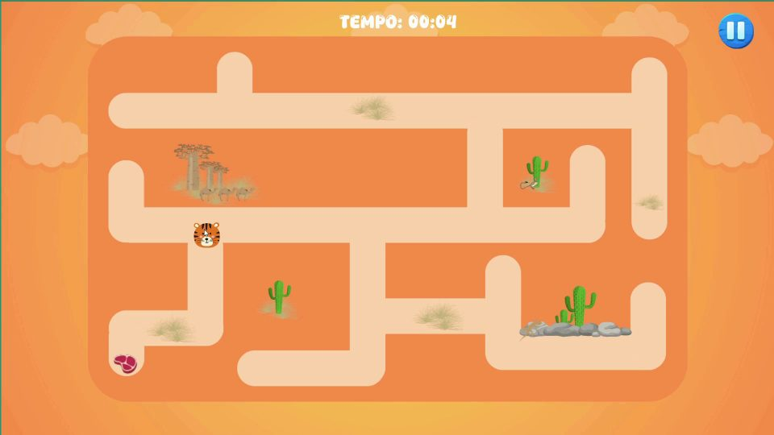
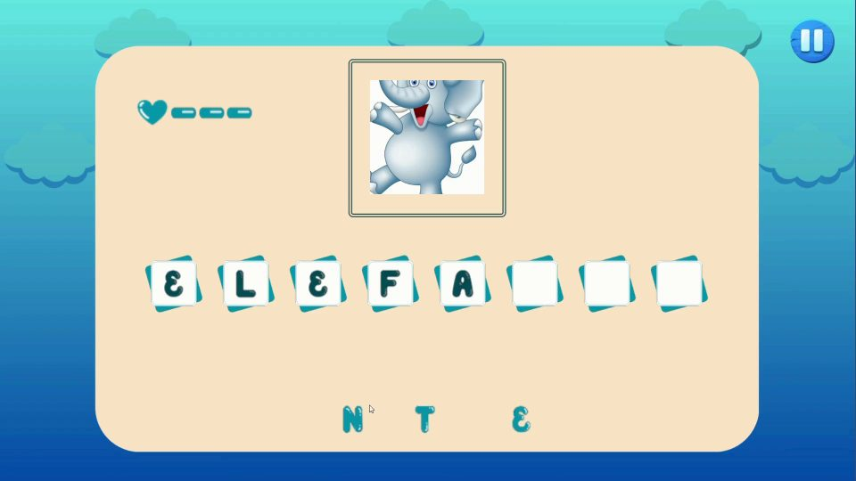
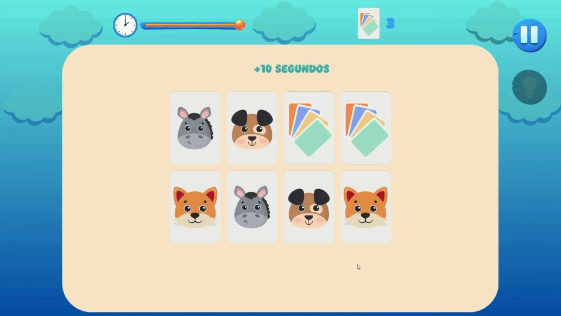
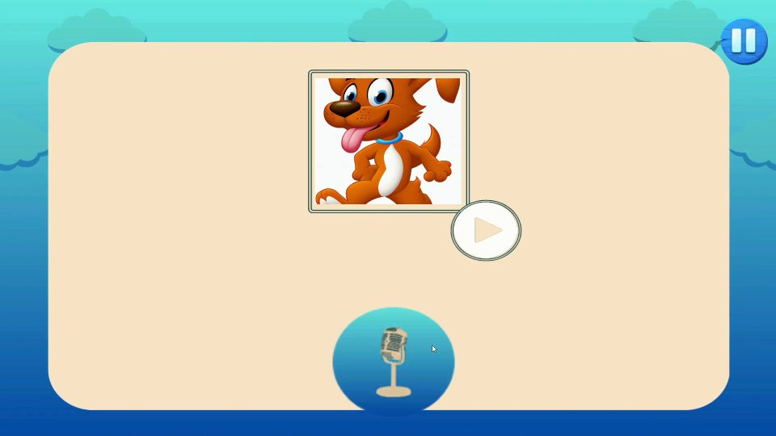

# Learn Quest: jogo educativo para crianças com Síndrome de Down


**[Baixar para Windows e Android](https://github.com/DerickxP/Learn-Quest-Serious-Game/releases)**

Jogo **2D para PC e Android** que apoia o desenvolvimento motor, cognitivo e de fala de
crianças com Síndrome de Down de 4 a 9 anos. São quatro minijogos com dificuldade
progressiva; dois deles usam **IA generativa e reconhecimento de fala** para criar um
desafio novo a cada partida e **avaliar a pronúncia** da criança.

> Trabalho de Conclusão de Curso do Tecnólogo em Jogos Digitais, UniFacisa (2024),
> orientado pelo Prof. Esp. Armando Torres de Moura e Costa Agra e aprovado em 26/11/2024.


## Como funciona

Do menu, a criança escolhe um dos quatro modos e avança pelas fases em sequência, com a
dificuldade aumentando aos poucos.

| Modo | Como se joga | O que estimula |
|---|---|---|
| **Labirinto** | Escolhe um personagem (ovelha, macaco, gato ou tigre) e o arrasta até o prêmio no fim do labirinto, sem atravessar as paredes. São 5 fases com cronômetro. | Coordenação motora fina e raciocínio espacial |
| **Associação** | Vê a ilustração de um animal e arrasta as letras para formar o nome dele. São 5 fases, com 3 vidas em cada uma. | Alfabetização e coordenação motora |
| **Jogo da memória** | Encontra os pares antes de o tempo acabar: 70 s no primeiro nível e 60 s nos seguintes. Os pares aumentam a cada nível, dois acertos seguidos valem +10 s e há uma dica por nível. | Atenção e memória |
| **Pronúncia correta** | Ouve o nome do animal, grava a própria fala e recebe a avaliação. Ao acertar, descobre três curiosidades sobre o animal. São 5 fases. | Fala, dicção e vocabulário |

| Labirinto | Associação |
|:---:|:---:|
|  |  |
| **Jogo da memória** | **Pronúncia correta** |
|  |  |

Nos dois modos com IA, cada partida gera um desafio novo:

```
Associação
  └── ChatGPT (gpt-3.5-turbo) sorteia um animal
        ├── DALL·E desenha o animal em estilo cartoon (256×256)
        └── as letras do nome são espalhadas na tela

Pronúncia correta
  ├── ChatGPT sorteia o animal → DALL·E desenha (512×512) → Google Text-to-Speech fala o nome
  └── microfone grava 5 s (44,1 kHz) → WAV PCM 16-bit → base64
        └── Google Speech-to-Text (pt-BR) transcreve e compara com o nome do animal
              ├── acerto: ChatGPT gera três curiosidades sobre o animal
              └── quarto erro: tela de derrota
```

O código C# integra as quatro APIs REST com `UnityWebRequest` e corrotinas e com
`HttpClient` e `async/await`, tratando as respostas com Newtonsoft.Json. O áudio da
criança é convertido de `AudioClip` para WAV pela classe `WavUtility`, que também faz o
caminho inverso para tocar a voz sintetizada pelo Google. No labirinto, o personagem é
movido com `Rigidbody2D` e as colisões com as paredes o devolvem à última posição válida.

## Decisões de projeto

- **Dificuldade progressiva, sem seletor de nível.** A ideia inicial era deixar a criança
  escolher a dificuldade. Para evitar que ela se acomodasse num nível fácil, a
  dificuldade passou a subir sozinha: mais pares no jogo da memória e fases em sequência
  nos outros modos.
- **Toque e arrasto em vez de realidade aumentada.** A primeira proposta era um jogo em
  AR com captura dos movimentos do corpo, inviável no prazo do TCC. O jogo foi para o
  celular, onde arrastar com o dedo também trabalha a coordenação motora fina.
- **DALL·E em vez de banco de imagens.** A API do Unsplash foi testada, mas não tinha
  imagens no estilo cartoon do jogo. Gerar a ilustração mantém a estética para qualquer
  animal que o ChatGPT sortear.
- **Imagens menores para carregar mais rápido.** Ajustar as requisições e pedir as
  ilustrações da Associação em 256×256 reduziu o tempo de geração de cerca de 20 s para
  cerca de 10 s, medido durante o desenvolvimento.

## Como rodar

Requisitos: [Unity Hub](https://unity.com/download) com o editor **Unity 2021.3.19f1
(LTS)** e, para gerar o APK, o módulo *Android Build Support*.

```bash
git clone https://github.com/DerickxP/Learn-Quest-Serious-Game.git
```

1. No Unity Hub, clique em **Add → Add project from disk** e selecione a pasta clonada.
2. Copie `ApiKeys.example.json` para `Assets/Resources/ApiKeys.json` e preencha
   `openAiApiKey` com uma chave da [OpenAI](https://platform.openai.com/api-keys) e
   `googleCloudApiKey` com uma chave do [Google Cloud](https://console.cloud.google.com/apis/credentials)
   que tenha as APIs **Cloud Speech-to-Text** e **Cloud Text-to-Speech** ativadas.
3. Abra `Assets/Scenes/Menu.unity` e aperte **Play**.

## Estrutura

```
Assets/
├── Scenes/                 # 22 cenas na build: menu, seleção de modo e fases
│   ├── Labirinto/          # escolha de personagem + LAB1 a LAB5
│   ├── Associação/         # Fase 01 a 05
│   ├── MemoriaInterativa/
│   └── Pronuncia Correta/  # PC - Fase 01 a 05
├── Scritps/                # código C# do jogo
│   ├── Labirinto/          # arrastar personagem, colisões e troca de fase
│   ├── Associação/         # letras arrastáveis, validação da palavra, ChatGPT e DALL·E
│   ├── Jogo da Memoria/    # cartas, embaralhamento, cronômetro e dicas
│   ├── Pronuncia Correta/  # gravação, Speech-to-Text, Text-to-Speech, ChatGPT e DALL·E
│   ├── ApiConfig.cs        # leitura das chaves de API
│   ├── AudioManager.cs     # música e efeitos sonoros, persistente entre cenas
│   └── LegendaManager.cs   # instruções com efeito de digitação
├── Sprites/                # arte 2D (Photoshop, Illustrator e Canva), áudios e músicas
├── Resources/              # cartas, letras e imagens carregadas em tempo de execução
└── Plugins/                # Newtonsoft.Json (via NuGetForUnity)
docs/                       # telas e GIF de gameplay
```

## Limitações

- Associação e Pronúncia correta dependem de internet e de chaves próprias da OpenAI e
  do Google Cloud. Labirinto e Jogo da memória funcionam offline.
- É o protótipo entregue no TCC: cinco fases no Labirinto, na Associação e na
  Pronúncia, com o conteúdo centrado em animais.
- O jogo não foi testado com o público-alvo; isso exigiria autorizações legais que não
  couberam no prazo do TCC.
- O modo para daltonismo (deuteranopia e protanopia) foi desenhado, mas não entrou no
  protótipo.
- As versões PC e Android ficaram em projetos separados, com o mesmo código e o layout
  das cenas ajustado à mão para o celular; este repositório traz o projeto da versão PC.
  Hoje o caminho seria um único projeto com interface adaptável às duas telas.

## Licença

[MIT](LICENSE).

Os recursos de terceiros mantêm as licenças dos seus autores:

- Música: "Quirky Dog", de Kevin MacLeod ([incompetech.com](https://incompetech.com)),
  licença CC BY 4.0.
- Efeitos sonoros: [Freesound](https://freesound.org).
- [Newtonsoft.Json](https://www.newtonsoft.com/json): licença MIT.
